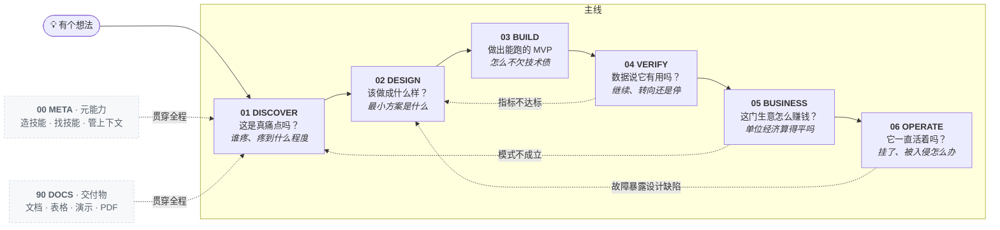

<div align="center">

# AI Builder Skills

**从「我有个想法」到「有人愿意付钱」的完整作战手册**

面向 AI 编程助手与智能体（Agent）的技能库 · 按 Builder 的真实工作顺序组织

[🗺 旅程地图](#-builder-旅程地图) · [📇 技能索引](INDEX.md) · [➕ 新增技能](CONTRIBUTING.md)

</div>

---

## 这是什么

这不是一个技能收藏夹，而是一条**被拆成可执行步骤的产品建造流水线**。

大多数技术人的困境不是"不会写代码"，而是：需求是假的、MVP 做大了、上线后没人用、看不懂这门生意怎么赚钱、系统半夜挂了不知道从哪查。这个仓库把 AI Builder 的完整闭环拆成六个阶段，每个阶段配一组可以直接调用的技能：

> **发现真痛点 → 定义方案 → 做出 MVP → 用数据验证 → 看懂生意 → 长期运维**

目录结构本身就是方法论。你不需要记住有哪些技能，只需要知道**自己现在卡在哪一步**。

## 🗺 Builder 旅程地图



**读图方式**：实线是前进方向，虚线是回退 —— 回退不是失败，是这套流程最有价值的部分。绝大多数项目死在没有勇气回退。

## 📁 目录结构

```
ai-builder-skills/
├── README.md          # 你在这里：旅程地图与上手方式
├── INDEX.md           # 全量技能索引，按触发词速查
├── CONTRIBUTING.md    # 新增技能的规范、验收清单与结构设计原则
│
├── 00-meta/           # 元能力：造技能、找技能、管上下文         (4)
├── 01-discover/       # 发现真问题：需求澄清、痛点验证           (4)
├── 02-design/         # 定义方案：架构、计划、界面               (6)
├── 03-build/          # 做出 MVP：编码纪律、版本控制、提示工程   (8)
├── 04-verify/         # 验证价值：测试、审查、调试、指标         (5)
├── 05-business/       # 看懂生意：商业模式、单位经济、行业       (2)
├── 06-operate/        # 长期运维：故障排查、安全、应急、合规     (1)
└── 90-docs/           # 交付物：Word / PDF / PPT / Excel / 文档  (5)
```

数字前缀保留了流程顺序，因此在任何文件浏览器里都会自动排成正确的先后。

每个阶段目录下都有一个 `README.md`，统一回答五件事：

| 它回答 | 说明 |
| --- | --- |
| **要回答什么问题** | 这一步的核心疑问，答不上来就不该往下走 |
| **什么时候进入** | 明确的准入条件，避免跳步 |
| **产出物是什么** | 这一步必须留下什么，否则等于没做 |
| **有哪些技能** | 可直接调用的技能清单 |
| **常见反模式** | 这一步最典型的自欺欺人方式 |

## 🚀 快速开始

**方式一：让 Agent 自己挑**（推荐）

把仓库地址给支持 Skills 的 AI 编程助手，让它读 `INDEX.md`，然后直接描述你的处境：

> 我有个想法，但不确定是不是真需求，帮我看看。

索引里的触发词会自动把它路由到 `01-discover`。

**方式二：按阶段手动取用**

1. 判断你在哪一步（参考上面的旅程地图）
2. 进入对应阶段目录，读它的 `README.md`
3. 打开具体技能的 `SKILL.md`，按里面的触发条件与工作流执行

**方式三：直接装技能**

每个技能目录是自包含的，例如 `01-discover/pain-point-discovery/` 可以直接拷贝进你的 skills 目录使用。

## 📇 技能一览

> 完整触发词索引见 [INDEX.md](INDEX.md)。下表按 Builder 旅程排序。

### 00-meta — 元能力

贯穿全程的基础设施：怎么造技能、怎么找技能、怎么让 Agent 记住跨会话的上下文。

| 技能 | 用途 |
| --- | --- |
| [`skill-creator`](00-meta/skill-creator/) | 创建、迭代并评测自己的技能 |
| [`find-skills`](00-meta/find-skills/) | 在技能生态中检索与安装现成技能 |
| [`dsh-plugin-publish`](00-meta/dsh-plugin-publish/) | 把自研 DSH 插件发布到插件市场并刷 CDN |
| [`memory-bank`](00-meta/memory-bank/) | 分层记忆、会话续接与上下文压缩 |

### 01-discover — 发现真问题

**核心问题：谁在疼？疼到什么程度？他会为此付钱还是只会说"这个想法不错"？**

| 技能 | 用途 |
| --- | --- |
| [`product-kickoff`](01-discover/product-kickoff/) | **产品开工与原型评审**。访谈前预研人工业务，结合开源候选回访查漏，分阶段记录一期范围、底座评估和开工条件，交付开工方案与 PRD。也可单独找底座、写 PRD 或制作带联动旁注的 Web / APP / H5 原型。 |
| [`pain-point-discovery`](01-discover/pain-point-discovery/) | 用户访谈、痛点真假鉴别、JTBD —— 把"朋友都说好"变成可证伪的证据 |
| [`brainstorming`](01-discover/brainstorming/) | 实现前的需求澄清与方案发散，**动手前的硬性门槛** |
| [`project-planner`](01-discover/project-planner/) | 把模糊想法归类为提案、Issue 或缺陷报告 |

### 02-design — 定义方案

**核心问题：要解决这个问题，最小且正确的方案长什么样？**

| 技能 | 用途 |
| --- | --- |
| [`architecture-patterns`](02-design/architecture-patterns/) | Clean / Hexagonal / DDD 等后端架构模式与分层实践 |
| [`architecture-doc-writer`](02-design/architecture-doc-writer/) | 按模板产出系统架构与技术设计文档（含 Mermaid 图） |
| [`writing-plans`](02-design/writing-plans/) | 动手写代码前，把规格拆解为可执行的实施计划 |
| [`planning-with-files`](02-design/planning-with-files/) | 文件化规划：用 `task_plan.md` 跟踪复杂任务进度 |
| [`frontend-design`](02-design/frontend-design/) | 生产级前端界面设计与实现 |
| [`ui-ux-pro-max`](02-design/ui-ux-pro-max/) | 可检索的 UI/UX 设计参考数据库（配色、排版、组件） |

### 03-build — 做出 MVP

**核心问题：怎么在最短时间内做出一个"能验证假设"的东西，而不是一个半成品？**

| 技能 | 用途 |
| --- | --- |
| [`evaluate-feature-value`](03-build/evaluate-feature-value/) | **功能级投入决策**：对比现有做法算增量价值与持续成本，设计最小验证，给出做 / 先验证 / 改用简方案 / 暂缓 |
| [`mvp-scoping`](03-build/mvp-scoping/) | MVP 范围裁剪、功能砍杀、最小可验证闭环、上线前 checklist |
| [`test-driven-development`](03-build/test-driven-development/) | TDD 流程：先写测试，再写实现 |
| [`executing-plans`](03-build/executing-plans/) | 按计划分阶段执行，并在关键点设置检查 |
| [`git`](03-build/git/) | 组织级 Git 工作流：三主干、五类临时分支、提交规范 |
| [`logging-standards`](03-build/logging-standards/) | 日志级别、结构化、脱敏与性能记录规范 |
| [`prompt-engineering-expert`](03-build/prompt-engineering-expert/) | 面向 Agent 的提示词与自定义指令设计 |
| [`web-artifacts-builder`](03-build/web-artifacts-builder/) | 复杂多组件前端产物（状态、路由、组件库）的构建指引 |

### 04-verify — 验证价值

**核心问题：有什么证据能证明它真的有用？什么情况下我应该承认它没用了？**

| 技能 | 用途 |
| --- | --- |
| [`value-validation`](04-verify/value-validation/) | 北极星指标、留存与激活、实验设计、停止/转向判据 |
| [`systematic-debugging`](04-verify/systematic-debugging/) | 结构化排查缺陷，定位根因而非贴创可贴 |
| [`requesting-code-review`](04-verify/requesting-code-review/) | 合并前的代码审查与质量核对 |
| [`auto-testcase-generator`](04-verify/auto-testcase-generator/) | 从需求 / API / 项目文档生成结构化 Excel 测试用例 |
| [`web-design-guidelines`](04-verify/web-design-guidelines/) | Web 界面规范、可访问性与体验合规审查 |

### 05-business — 看懂生意

**核心问题：这东西怎么变成钱？数字算得平吗？这个行业我该怎么在几天内摸熟？**

| 技能 | 用途 |
| --- | --- |
| [`business-model-fluency`](05-business/business-model-fluency/) | 商业模式画布、价值主张、单位经济（CAC/LTV/毛利）、陌生行业速通法 |
| [`a-share-fundamentals`](05-business/a-share-fundamentals/) | A 股基本面分析：AKShare 取数 + 四维度量化评估 |

### 06-operate — 长期运维

**核心问题：系统上线之后靠什么一直活着？出故障、被入侵、被要求合规时第一步做什么？**

| 技能 | 用途 |
| --- | --- |
| [`it-ops-personal`](06-operate/it-ops-personal/) | 服务器与数据库故障排查、安全加固、备份恢复、监控日志、应急响应与数据合规自查 |

### 90-docs — 交付物

技术之外，Builder 还要交付给人看的东西。

| 技能 | 用途 |
| --- | --- |
| [`technical-writer`](90-docs/technical-writer/) | 技术文档、用户指南、知识库写作 |
| [`docx`](90-docs/docx/) | Word 文档创建、编辑与格式处理 |
| [`pdf`](90-docs/pdf/) | PDF 读取、合并、拆分与表单处理 |
| [`pptx`](90-docs/pptx/) | 演示文稿生成与编辑 |
| [`xlsx`](90-docs/xlsx/) | 表格数据处理、公式与图表 |

## 🧩 技能目录规范

每个技能是一个自包含目录：

```
<技能名>/
├── SKILL.md          # 技能入口（必填，唯一入口）
├── _meta.json        # 发布元数据：ownerId / slug / version / publishedAt
├── LICENSE.txt       # 许可证
├── agents/           # 各 Agent 平台的展示配置（如 agents/openai.yaml）
├── references/       # 深度参考文档，按需加载
├── scripts/          # 可执行辅助脚本
├── examples/         # 示例
├── templates/        # 模板文件
└── assets/           # 静态资源
```

除技能自身的入口文件外，子资源全部**按需加载** —— 不要写进 `SKILL.md` 正文，否则会白白吃掉上下文。

**`SKILL.md` 格式：**

```markdown
---
name: skill-name
description: Use when <触发条件与症状>。不要在这里概括工作流。
---

# 技能标题

## Overview
这个技能是什么，核心原则一句话。

## When to Use
具体症状、场景，以及什么时候**不**该用。

## 工作流 / 核心模式
可执行的步骤、对照表、代码示例。

## Common Mistakes
常见错误与修正方式。
```

小节可以用英文名（`Overview` / `When to Use` / `Common Mistakes`）或中文名（`这个技能解决什么` / `触发条件` / `常见错误`），**同一个文件内保持一致**即可。仓库现状是两者混用，属于历史原因。

**命名约定**

- 技能入口统一为 `SKILL.md`（历史遗留例外：`03-build/logging-standards/skill.md`）
- 目录名 kebab-case，**尽量**动词优先（`writing-plans` 优于 `plans-writer`）；名词性概念同样可接受（如 `pain-point-discovery`、`business-model-fluency`）。仓库现状为混合，新技能建议向动词优先靠拢
- `_meta.json` 里的 `slug` 是技能市场的**唯一安装标识**，与目录路径解耦 —— 移动目录不影响已发布技能的安装

## 🤝 参与

新增或修改技能前请先读 [CONTRIBUTING.md](CONTRIBUTING.md)，里面有完整的规范、验收清单，以及**为什么是这个目录结构**的设计记录。

## 📄 许可

各技能目录内的 `LICENSE.txt` 为准；未附带的默认遵循仓库根目录约定。
